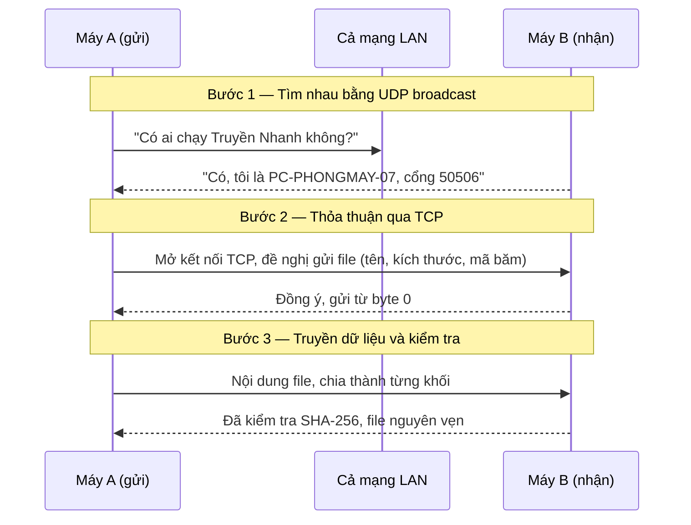

# Truyền Nhanh

**Gửi file giữa các máy trong cùng mạng LAN — không cần Internet, không cần USB, không qua Zalo.**

Đồ án môn **Lập trình mạng** · Nhóm 6 người · 26/10/2026 – 29/11/2026

---

## Đề tài là gì?

Hai máy tính đang dùng chung một mạng WiFi (hoặc cùng cắm dây trong phòng máy). Bạn muốn chuyển một file từ máy này sang máy kia.

Hiện giờ mọi người làm thế nào? Gửi qua Zalo thì ảnh bị nén, file lớn bị giới hạn. Tải lên Google Drive rồi tải xuống thì phải đi vòng ra Internet, mạng trường chậm thì chờ mãi. Dùng USB thì phải có USB và phải cầm sang tận nơi.

**Truyền Nhanh giải quyết đúng việc đó:** bật ứng dụng trên hai máy, chúng tự tìm thấy nhau, bạn chọn file và bấm Gửi. Dữ liệu đi thẳng từ máy này sang máy kia qua mạng nội bộ, không đi ra Internet.

Ý tưởng giống LocalSend hay AirDrop, nhưng **nhóm tự viết toàn bộ phần mạng** — tự định nghĩa giao thức, tự xử lý từng byte. Đó là lý do nó là đề tài lập trình mạng chứ không phải đề tài làm ứng dụng.

## Người dùng thấy gì

```
┌─────────────────────────────────────────────────────┐
│  Truyền Nhanh                    Tên máy: LAPTOP-LONG │
├─────────────────────────────────────────────────────┤
│  Máy trong mạng                                       │
│   ● PC-PHONGMAY-07     192.168.1.35                   │
│   ● LAPTOP-NGAN        192.168.1.12                   │
│   [ + Thêm máy theo IP ]                              │
│                                                       │
│  [ Chọn file... ]   bao_cao_cuoi_ky.pdf    [  Gửi  ]  │
│                                                       │
│  Đang gửi tới PC-PHONGMAY-07                          │
│  ██████████████░░░░░░░░  62%   8,4 MB/s   còn 12 giây │
│                                         [ Hủy ]       │
│                                                       │
│  Đã nhận                                              │
│   bai_tap_tuan_5.zip    từ LAPTOP-NGAN      14:32     │
└─────────────────────────────────────────────────────┘
```

Bên nhận sẽ thấy hộp thoại *"LAPTOP-LONG muốn gửi bao_cao_cuoi_ky.pdf (24 MB). Nhận không?"* — không ai gửi được file vào máy bạn nếu bạn không đồng ý.

## Bên trong hoạt động thế nào

Ba bước, mỗi bước dùng một kiến thức của môn học:



- **Bước 1** dùng **UDP broadcast**: hét một câu cho cả mạng nghe, ai đang chạy ứng dụng thì trả lời. Không cần biết trước IP của ai.
- **Bước 2 và 3** dùng **TCP**: kết nối tin cậy giữa đúng hai máy. Vì TCP chỉ là một dòng byte liên tục, nhóm phải **tự định nghĩa giao thức** để biết đâu là tên file, đâu là nội dung, đâu là kết thúc.
- **Mã băm SHA-256** đảm bảo file nhận được giống hệt file gốc, không sai một bit.
- **Truyền tiếp:** nếu rớt mạng giữa chừng, lần sau chỉ gửi phần còn thiếu chứ không gửi lại từ đầu.

## Kiến thức môn học được áp dụng

| Kiến thức (slide Chương 1 của thầy) | Nằm ở đâu trong đề tài |
|---|---|
| Mô hình TCP/IP, giao thức là gì | Nhóm tự thiết kế một giao thức tầng ứng dụng, chạy trên TCP và UDP |
| Địa chỉ IP, vùng địa chỉ riêng cho LAN (`192.168.x.x`) | Dò tìm chỉ hoạt động trong mạng nội bộ; IP của máy lấy từ gói tin |
| Mô hình Client/Server | Mỗi máy vừa là server (chờ nhận file) vừa là client (đi gửi file) |
| Mô hình Peer-to-Peer | Không có máy chủ trung tâm nào, các máy ngang hàng nói chuyện trực tiếp |
| Cổng (port), socket | UDP cổng 50505 để dò tìm, TCP cổng 50506 để truyền file |
| Thứ tự byte mạng (big-endian) | Độ dài khung trong giao thức được ghi theo thứ tự byte mạng |

## Tính năng

**Bắt buộc** — phải có để đạt yêu cầu
- Tự phát hiện các máy trong mạng; thêm máy thủ công theo IP khi mạng chặn dò tìm
- Gửi một file bất kỳ, người nhận phải đồng ý trước
- Hiển thị tiến độ, tốc độ, thời gian còn lại
- Kiểm tra toàn vẹn bằng SHA-256
- Chống tên file độc hại ghi đè ra ngoài thư mục nhận
- Có cả giao diện đồ họa và dòng lệnh

**Nâng cao** — làm nên điểm cao
- Truyền tiếp khi đứt kết nối, không gửi lại phần đã nhận
- Nhiều lượt gửi và nhận cùng lúc
- Bộ số liệu đo đạc: tốc độ theo kích thước khối, so sánh với Zalo, Google Drive, USB

**Mở rộng** — chỉ làm khi dư thời gian
- Điện thoại gửi file lên máy tính qua trình duyệt, không cần cài app

## Thành viên và vai trò

> Mỗi người điền tên và tài khoản GitHub của mình qua PR đầu tiên (nhiệm vụ T02).

| Vai | Phụ trách | Thành viên | GitHub |
|---|---|---|---|
| R1 | Trưởng nhóm · Giao thức & Lõi | Nguyễn Duy Long | duylong06 |
| R2 | Dò tìm thiết bị (UDP) & Dòng lệnh | Như |nhunth7569-byte|
| R3 | Bên gửi (TCP client) | Ngô Hồng Hải | |
| R4 | Bên nhận (TCP server) | Lê Võ Thành Nam | |
| R5 | Giao diện (Tkinter) | Lê Đức Anh | |
| R6 | Kiểm thử · Đo đạc · Báo cáo | Bùi Kim Hồ | |

Chi tiết từng vai làm gì, sở hữu file nào, cần gì từ ai: [docs/04-phan-cong.md](docs/04-phan-cong.md).

## Lộ trình 5 tuần

| Tuần | Thời gian | Chủ đề | Mốc phải đạt |
|---|---|---|---|
| 1 | 26/10 – 01/11 | Nền móng | Đặc tả giao thức v1.0 đã chốt, ai cũng có PR đầu tiên |
| 2 | 02/11 – 08/11 | Từng mảnh chạy riêng | Gửi được 1 file giữa 2 máy bằng dòng lệnh |
| 3 | 09/11 – 15/11 | Ghép nối & truyền tiếp | Bản đủ tính năng, giao diện chạy thật |
| 4 | 16/11 – 22/11 | Cứng cáp & đo đạc | Đóng băng mã nguồn, đủ số liệu đo |
| 5 | 23/11 – 29/11 | Báo cáo & demo | Nộp bài |

Chi tiết từng tuần: [docs/05-lo-trinh.md](docs/05-lo-trinh.md).

## Bắt đầu

Cần **Python 3.10 trở lên** và **Git**. Trên Windows, khi cài Python nhớ tích ô *Add Python to PATH*; Tkinter đã có sẵn trong bộ cài.

```bash
git clone <địa chỉ repo của nhóm>
cd LapTrinhMang
python -m venv .venv
.venv\Scripts\activate          # Windows
# source .venv/bin/activate     # macOS / Linux
pip install -e ".[dev]"
pytest
python -m truyennhanh
```

Lúc này chương trình chỉ in ra danh sách lệnh dự kiến, vì **mọi hàm trong `src/` đang là khung** — có chữ ký và mô tả, thân hàm là `raise NotImplementedError`. Mỗi người điền phần của mình theo nhiệm vụ được giao.

## Cấu trúc thư mục

```
LapTrinhMang/
├── src/truyennhanh/
│   ├── protocol/        R1  Đóng khung và thông điệp — hợp đồng giữa bên gửi và bên nhận
│   ├── core/            R1  Lõi ứng dụng: điều phối mọi thành phần, phát sự kiện cho giao diện
│   ├── discovery/       R2  Dò tìm thiết bị bằng UDP broadcast
│   ├── cli/             R2  Giao diện dòng lệnh
│   ├── transfer/        R3  sender.py, hashing.py — bên gửi
│   │                    R4  receiver.py, storage.py, filenames.py — bên nhận
│   ├── gui/             R5  Giao diện Tkinter
│   └── config.py        R1  Cấu hình
├── tests/               R6  Kiểm thử tự động
├── tools/               R6  Công cụ tạo file mẫu, đo đạc
├── ket-qua/             R6  Số liệu đo (CSV)
├── docs/                    Tài liệu dự án
└── scripts/                 Script tạo issue trên GitHub
```

## Tài liệu

Đọc theo thứ tự. Ba file đầu **ai cũng phải đọc** trong tuần 1.

| File | Nội dung | Ai đọc |
|---|---|---|
| [01-de-cuong.md](docs/01-de-cuong.md) | Đề cương: mục tiêu, phạm vi, yêu cầu, rủi ro | Cả nhóm |
| [02-kien-truc.md](docs/02-kien-truc.md) | Kiến trúc, các module, mô hình luồng, quyết định thiết kế | Cả nhóm |
| [03-dac-ta-giao-thuc.md](docs/03-dac-ta-giao-thuc.md) | Đặc tả giao thức đến từng byte | Cả nhóm, R1–R4 đọc kỹ |
| [04-phan-cong.md](docs/04-phan-cong.md) | Việc của từng người, chi tiết từng nhiệm vụ | Cả nhóm |
| [05-lo-trinh.md](docs/05-lo-trinh.md) | Lịch 5 tuần, họp nhóm, phương án dự phòng | Cả nhóm |
| [06-quy-trinh-git.md](docs/06-quy-trinh-git.md) | Cách dùng Git và GitHub trong nhóm | Cả nhóm |
| [07-ke-hoach-do-dac.md](docs/07-ke-hoach-do-dac.md) | Các thí nghiệm lấy số liệu cho báo cáo | R3, R6 |
| [08-kiem-thu.md](docs/08-kiem-thu.md) | Kế hoạch kiểm thử | R4, R6 |
| [00-khoi-tao-repo.md](docs/00-khoi-tao-repo.md) | Đưa dự án lên GitHub, tạo issue tự động | R1 |
| [huong-dan-tuong-lua.md](docs/huong-dan-tuong-lua.md) | Mở tường lửa, xử lý không thấy máy kia — R2 viết ở T06 | Cả nhóm, khi gặp sự cố |
| [huong-dan-su-dung.md](docs/huong-dan-su-dung.md) | Hướng dẫn cho người dùng cuối — R2 viết ở T46 | Người dùng |
| [bao-cao/dan-y-bao-cao.md](docs/bao-cao/dan-y-bao-cao.md) | Dàn ý báo cáo, ai viết phần nào | Cả nhóm (tuần 5) |

## Quy ước nhanh

- Không ai đẩy thẳng lên `main`. Mọi thay đổi đi qua **Pull Request** và cần **1 người duyệt**.
- Mỗi nhiệm vụ có mã `Txx`. Tên nhánh và commit bắt đầu bằng mã đó, ví dụ nhánh `T15-phat-announce`, commit `[T15] Thêm vòng lặp phát ANNOUNCE`.
- Vướng quá một ngày thì gắn nhãn `can-ho-tro` vào issue và báo nhóm ngay.
- Tên hàm, biến bằng tiếng Anh; chú thích và docstring bằng tiếng Việt.

Chi tiết: [docs/06-quy-trinh-git.md](docs/06-quy-trinh-git.md).

## Ngôn ngữ và công nghệ

**Python 3.10+**, chỉ dùng thư viện chuẩn: `socket`, `threading`, `hashlib`, `json`, `tkinter`. Không cần cài thư viện ngoài để chạy (chỉ cần `pytest` để kiểm thử).

Lý do chọn Python: module `socket` của Python ánh xạ gần như một-một với các lệnh `bind`, `listen`, `accept`, `connect`, `send`, `recv` trong giáo trình, nên code đọc lên là thấy ngay khái niệm mạng; chạy được trên Windows, macOS, Linux mà không cần Visual Studio; và cả nhóm 6 người dễ tiếp cận như nhau.

Nếu thầy yêu cầu C#: kiến trúc, đặc tả giao thức, phân công và lộ trình giữ nguyên hoàn toàn, chỉ phần `src/` viết lại bằng C#. Giao thức được thiết kế độc lập ngôn ngữ — một bên viết Python vẫn nói chuyện được với một bên viết C#.
