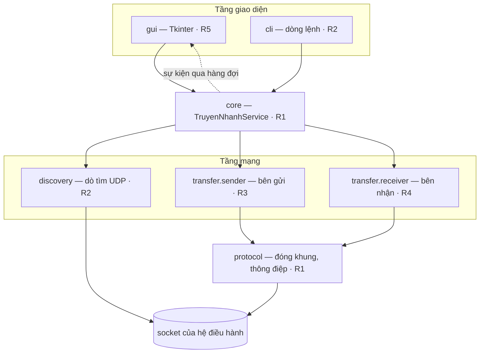
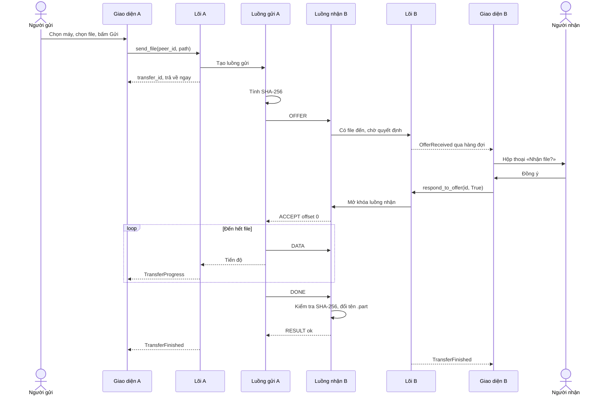

# Kiến trúc

## 1. Tổng quan

Ứng dụng chia thành bốn tầng. **Mỗi tầng chỉ gọi xuống tầng ngay dưới nó**, và báo ngược lên bằng sự kiện.



**Ngang hàng hay client–server?** Cả hai, tùy nhìn ở mức nào. Ở mức hệ thống, không có máy chủ trung tâm nào: mọi máy chạy cùng một chương trình, vừa chờ nhận file (vai server) vừa đi gửi file (vai client) — đó là kiến trúc **ngang hàng (P2P)**. Nhưng mỗi lượt truyền cụ thể là một phiên **client–server** thuần túy: máy gửi chủ động kết nối tới cổng TCP đang lắng nghe của máy nhận. Phân biệt được hai mức này là một ý đáng trình bày trong báo cáo.

## 2. Các module

| Thư mục | Phụ trách | Trách nhiệm | Dùng |
|---|---|---|---|
| `protocol/` | R1 | Hằng số giao thức; đóng khung và mở khung trên dòng byte TCP; tạo và kiểm tra thông điệp JSON | socket |
| `core/` | R1 | Điều phối: khởi động và dừng mọi thành phần, giữ danh sách lượt truyền, nhận quyết định của người dùng, phát sự kiện | discovery, transfer |
| `config.py` | R1 | Cấu hình: tên máy, thư mục nhận, cổng, kích thước khối | — |
| `discovery/` | R2 | Phát và nghe gói dò tìm UDP; bảng thiết bị có hết hạn | socket |
| `cli/` | R2 | Lệnh `scan`, `send`, `receive`, `ui` | core |
| `transfer/hashing.py`, `sender.py` | R3 | Tính SHA-256; gửi một file qua một kết nối TCP; truyền tiếp và thử lại | protocol |
| `transfer/receiver.py`, `storage.py`, `filenames.py` | R4 | Máy chủ TCP; nhận một file; quản lý `.part`; làm sạch tên file | protocol |
| `gui/` | R5 | Cửa sổ Tkinter; dịch vụ giả để làm giao diện trước khi có phần mạng | core |

**Quy tắc phụ thuộc** — vi phạm sẽ bị yêu cầu sửa khi duyệt PR:

- `gui/` và `cli/` **không** import `socket`, `discovery`, `transfer`. Chúng chỉ nói chuyện với `core`.
- `transfer/` và `discovery/` **không** import `gui`, `cli`, `core`. Chúng báo trạng thái qua hàm `emit` được truyền vào.
- Chỉ `protocol/` biết định dạng byte trên đường truyền.

Nhờ vậy R5 làm giao diện trên dịch vụ giả từ tuần 1, và R3, R4 kiểm thử bên gửi, bên nhận mà không cần giao diện.

## 3. API của lõi

Đây là **hợp đồng** giữa giao diện và phần mạng, được chốt ở nhiệm vụ T05. Định nghĩa đầy đủ trong `src/truyennhanh/core/`.

**Lệnh** — giao diện gọi, mọi hàm **trả về ngay**, không bao giờ chờ mạng:

| Hàm | Làm gì |
|---|---|
| `start()` / `stop()` | Bật, tắt dò tìm và máy chủ nhận |
| `list_peers()` | Danh sách máy đang thấy |
| `add_manual_peer(ip, port)` | Thêm máy theo IP |
| `send_file(peer_id, path)` | Bắt đầu gửi; trả về `transfer_id` ngay, việc gửi chạy ở luồng riêng |
| `respond_to_offer(transfer_id, accept)` | Người dùng đồng ý hoặc từ chối nhận |
| `cancel(transfer_id)` | Hủy một lượt |
| `set_download_dir(path)` | Đổi thư mục nhận |

**Sự kiện** — lõi đẩy vào `service.events` (một `queue.Queue`), giao diện lấy ra để vẽ:

| Sự kiện | Khi nào |
|---|---|
| `PeerFound` / `PeerLost` | Một máy xuất hiện, biến mất |
| `OfferReceived` | Có máy muốn gửi file tới; giao diện phải gọi `respond_to_offer` |
| `TransferStarted` | Một lượt bắt đầu truyền dữ liệu (gửi hoặc nhận) |
| `TransferProgress` | Tiến độ, tối đa 10 lần mỗi giây mỗi lượt |
| `TransferFinished` | Kết thúc: thành công, bị từ chối, lỗi hoặc bị hủy |
| `StatusMessage` | Thông báo trạng thái chung, ví dụ "Đang tính mã băm..." |

## 4. Mô hình luồng

Đây là phần dễ làm sai nhất, nên được quy định cứng từ đầu.

```
 Luồng chính (giao diện) ──── chỉ luồng này được đụng vào Tkinter
        ▲  mỗi 100 ms: root.after() lấy hết sự kiện trong hàng đợi
        │
 service.events  (queue.Queue — an toàn khi nhiều luồng cùng ghi)
        ▲            ▲              ▲                 ▲
        │            │              │                 │
 Luồng dò tìm   Luồng chấp nhận   Luồng nhận        Luồng gửi
 (nghe UDP +    kết nối TCP       (mỗi kết nối      (mỗi lượt gửi
  hẹn giờ phát)                    một luồng)        một luồng)
```

Bốn quy tắc:

1. **Chỉ luồng chính chạm vào Tkinter.** Tkinter không an toàn đa luồng — gọi nó từ luồng khác gây lỗi ngẫu nhiên, khó tái hiện.
2. **Luồng chính không bao giờ chờ mạng.** Gọi `send` hay `recv` trong hàm xử lý nút bấm sẽ làm cửa sổ đơ cứng suốt thời gian truyền. Mọi lệnh của lõi đều trả về ngay; việc mạng chạy ở luồng riêng.
3. **Luồng mạng báo lên bằng sự kiện**, không gọi thẳng hàm của giao diện.
4. **Quyết định của người dùng đi ngược bằng `threading.Event`.** Luồng nhận gặp OFFER thì phát `OfferReceived` rồi chờ trên một `Event` (tối đa 60 giây). Khi người dùng bấm, giao diện gọi `respond_to_offer`, lõi ghi quyết định và mở `Event` đó.

Vì sao dùng luồng mà không dùng `asyncio`: luồng khớp với ví dụ socket chặn (blocking) trong giáo trình, dễ đọc với người mới, và dễ kết hợp với Tkinter. Đánh đổi là mỗi kết nối tốn một luồng, nên không mở rộng tới hàng nghìn kết nối — nhưng ứng dụng trong một phòng học chỉ có vài kết nối cùng lúc.

## 5. Một lượt gửi file, từ đầu đến cuối



## 6. Lưu trữ phía nhận

```
Thư mục nhận (mặc định: <thư mục người dùng>/Downloads/TruyenNhanh)
├── bao_cao.pdf                  ← file đã xác minh SHA-256
├── bao_cao (1).pdf              ← trùng tên thì đánh số
└── .truyennhanh/                ← thư mục ẩn, nằm CÙNG ổ đĩa
    └── 9f2c4d1e...2a1f0e.part   ← đang nhận; tên file = SHA-256 của file gốc
```

- File đang nhận **chỉ** nằm trong `.truyennhanh/`. Người dùng không bao giờ thấy một file dở dang hay hỏng trong thư mục nhận.
- Tên `.part` là mã SHA-256 nên **chính nó là khóa truyền tiếp**: OFFER đến với mã băm trùng một `.part` có sẵn nghĩa là "file này đang nhận dở", và kích thước `.part` chính là vị trí cần gửi tiếp.
- `.truyennhanh/` đặt **bên trong** thư mục nhận để chắc chắn cùng ổ đĩa: thao tác đổi tên `os.replace` chỉ là tức thời (atomic) khi cùng ổ; khác ổ thì Windows báo lỗi.

## 7. Cấu hình mặc định

Định nghĩa trong `protocol/constants.py` (giá trị giao thức, không đổi được) và `config.py` (người dùng đổi được).

| Tham số | Giá trị | Ghi chú |
|---|---|---|
| Cổng dò tìm (UDP) | 50505 | Cố định, mọi máy phải giống nhau |
| Cổng nhận file (TCP) | 50506 | Bận thì để hệ điều hành chọn, cổng thật được phát trong ANNOUNCE |
| Chu kỳ phát ANNOUNCE | 2 giây | |
| Hết hạn thiết bị | 7 giây | Lỡ 3 gói ANNOUNCE liên tiếp |
| Kích thước khối dữ liệu | 64 KB | Tạm thời; chốt lại bằng thí nghiệm E1 |
| Chờ người nhận quyết định | 60 giây | |
| Kết nối im lặng tối đa | 15 giây | |

## 8. Các quyết định thiết kế

Mỗi quyết định ghi lại lựa chọn khác đã cân nhắc và cái giá phải trả. Phần này dùng trực tiếp cho chương Thiết kế của báo cáo.

**D1 — Dò tìm bằng UDP broadcast.**
Đã cân nhắc: multicast (phải tham gia nhóm, nhiều router và WiFi chặn, cấu hình phức tạp hơn); mDNS/Bonjour (cần thư viện ngoài); chỉ nhập IP tay (bất tiện). Broadcast là đơn giản nhất và chạy được ở hầu hết mạng gia đình, phòng máy.
*Đánh đổi:* broadcast không đi qua router, chỉ trong cùng mạng con — đúng phạm vi đề tài. Mạng nào chặn broadcast thì dùng thêm máy theo IP.

**D2 — Truyền file bằng TCP.**
Đã cân nhắc: UDP rồi tự làm cơ chế tin cậy. Làm vậy nghĩa là viết lại một phần TCP (xác nhận, gửi lại, sắp xếp thứ tự, kiểm soát tắc nghẽn) — ngoài sức 5 tuần và không phải mục tiêu môn học. Thí nghiệm E5 sẽ cho thấy bằng số UDP thuần làm mất và đảo thứ tự dữ liệu ra sao.

**D3 — Khung [độ dài 4 byte | loại 1 byte | nội dung].**
Đã cân nhắc: phân cách bằng ký tự xuống dòng như phần header của HTTP. Cách đó không dùng được cho dữ liệu nhị phân, vì nội dung file có thể chứa đúng ký tự xuống dòng. Ghi độ dài trước thì bên nhận biết chính xác cần đọc bao nhiêu byte, và từ chối được khung quá lớn trước khi cấp phát bộ nhớ.

**D4 — JSON cho thông điệp điều khiển, nhị phân thuần cho dữ liệu.**
JSON dễ đọc trong Wireshark, dễ gỡ lỗi, thêm trường mới không làm hỏng bên cũ. Chi phí vài trăm byte mỗi lượt là không đáng kể so với kích thước file. Riêng nội dung file đi trong khung DATA dạng nhị phân, không mã hóa gì thêm.

**D5 — SHA-256 toàn file, tính trước khi gửi.**
Đã cân nhắc: tính mã băm trong lúc gửi rồi gửi kèm ở cuối. Nhưng truyền tiếp cần mã băm **ngay trong OFFER** để bên nhận nhận ra file mình đang nhận dở.
*Đánh đổi:* file phải đọc hai lần (một lần băm, một lần gửi), nên giao diện phải báo "Đang tính mã băm..." với file lớn. Chọn SHA-256 thay vì MD5 vì MD5 đã bị phá về va chạm, còn tốc độ hai thuật toán tương đương nhau.

**D6 — Đa luồng thay vì asyncio.** Xem mục 4.

**D7 — Mỗi kết nối TCP chỉ truyền một file.**
Trạng thái đơn giản, lỗi ở file này không kéo theo file khác, truyền tiếp tự nhiên.
*Đánh đổi:* mỗi file tốn thêm một lần bắt tay TCP — khoảng 1 ms trong mạng LAN, không đáng kể.

**D8 — Địa chỉ IP của máy lấy từ gói tin, không lấy từ nội dung.**
Gói ANNOUNCE không chứa IP. Bên nghe lấy IP từ địa chỉ nguồn mà hệ điều hành báo khi nhận gói. Cách này luôn đúng kể cả khi máy gửi có nhiều card mạng, và máy gửi không khai man được địa chỉ.
