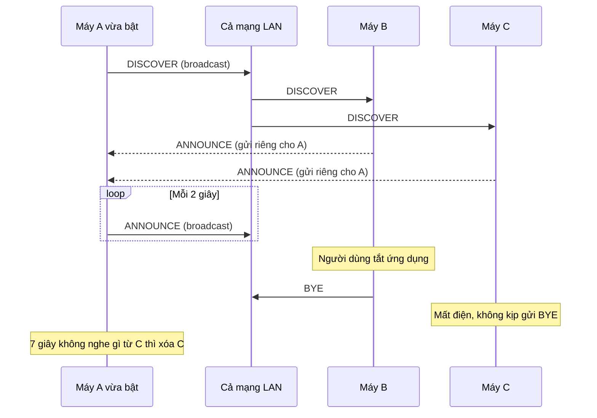
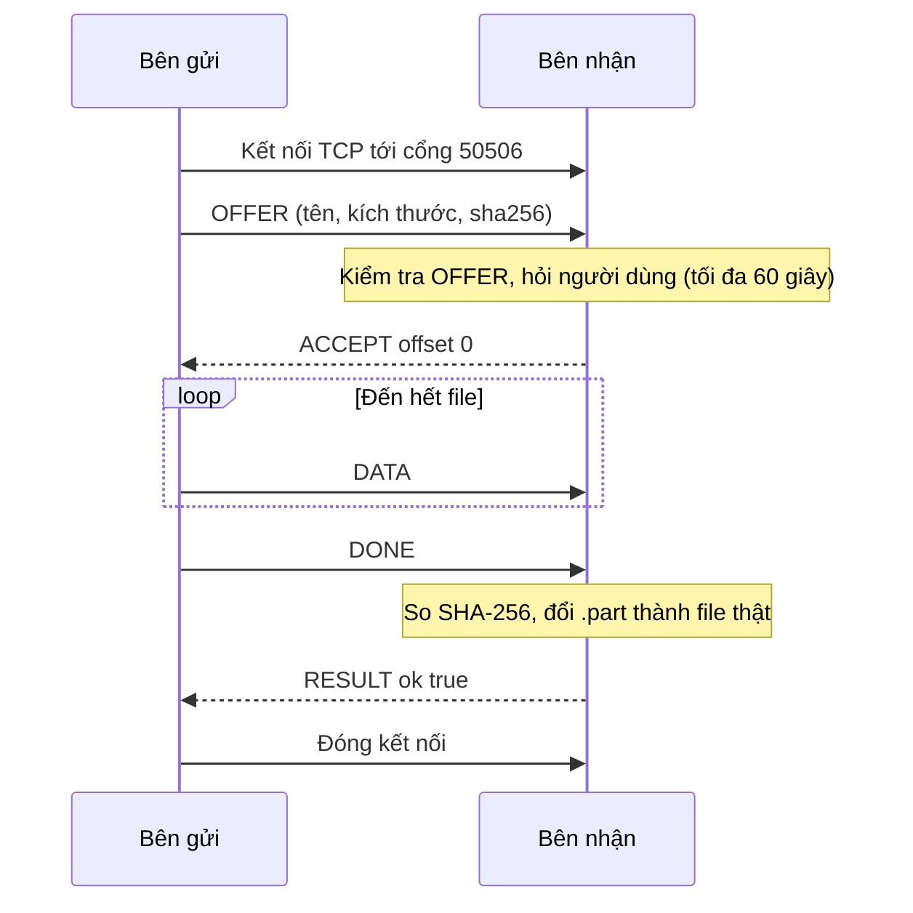
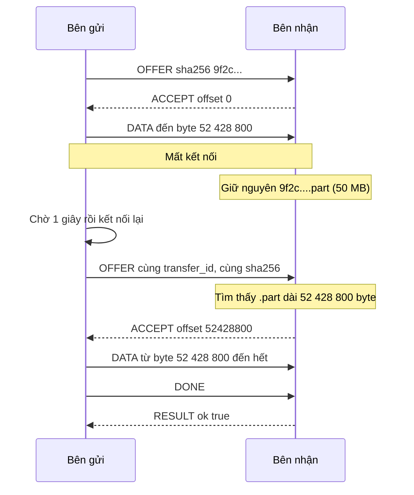

# Đặc tả giao thức Truyền Nhanh

| | |
|---|---|
| **Phiên bản** | 1.0 |
| **Trạng thái** | **Đã chốt** (T03, tuần 1). Mọi thay đổi từ đây phải qua PR do R1 duyệt |
| **Người giữ** | R1 — Nguyễn Duy Long |

Đây là **hợp đồng** giữa bên gửi (R3) và bên nhận (R4). Hai người viết code riêng, nhưng chương trình của họ chỉ nói chuyện được với nhau nếu cả hai làm **đúng từng byte** như tài liệu này. Có chỗ nào mơ hồ thì hỏi R1 và sửa tài liệu trước, sửa code sau.

**Từ khóa:** **PHẢI** = bắt buộc; **KHÔNG ĐƯỢC** = cấm; **NÊN** = khuyến nghị mạnh, bỏ qua thì phải có lý do; **CÓ THỂ** = tùy chọn.

---

## 1. Tổng quan

Truyền Nhanh gồm hai giao thức con:

| | Giao thức dò tìm | Giao thức truyền file |
|---|---|---|
| Tầng giao vận | UDP | TCP |
| Cổng | 50505 (cố định) | 50506 (mặc định, có thể khác) |
| Kiểu gửi | Broadcast cho cả mạng, và gửi riêng khi trả lời | Một kết nối giữa đúng hai máy |
| Định dạng | Mỗi gói là một đối tượng JSON | Chuỗi khung có độ dài đứng trước |
| Mục đích | Biết trong mạng có những máy nào | Gửi một file từ máy này sang máy kia |

## 2. Quy ước chung

- Văn bản mã hóa **UTF-8**.
- JSON viết **gọn**: không khoảng trắng, không xuống dòng (`separators=(",", ":")` trong Python).
- Số nguyên nhiều byte trong phần đầu khung ghi theo **thứ tự byte mạng (big-endian)**: byte có trọng số cao nhất đi trước.
- Bên nhận một thông điệp JSON **PHẢI bỏ qua** các trường lạ không có trong đặc tả. Nhờ vậy phiên bản sau thêm trường mới mà bản cũ vẫn chạy.
- `transfer_id` và `id` thiết bị là chuỗi UUID phiên bản 4, dạng 36 ký tự `xxxxxxxx-xxxx-4xxx-xxxx-xxxxxxxxxxxx`.
- Thời gian tính bằng giây.

---

## 3. Giao thức dò tìm (UDP, cổng 50505)

### 3.1 Socket

Mỗi máy dùng **đúng một socket UDP** cho cả gửi và nhận:

- Gắn (bind) vào địa chỉ `0.0.0.0`, cổng **50505**
- Bật `SO_BROADCAST` để được phép gửi tới địa chỉ broadcast
- Bật `SO_REUSEADDR` để chạy được hai bản trên cùng một máy khi thử nghiệm (trên macOS và Linux có thể cần thêm `SO_REUSEPORT` — R2 xác minh ở T06)

Dùng chung một socket nghĩa là mọi gói đi ra đều có **cổng nguồn 50505**, nên trả lời về đúng địa chỉ nguồn của gói là tới được nơi cần tới.

### 3.2 Định dạng gói

Mỗi gói UDP chứa đúng một đối tượng JSON, **tối đa 1024 byte**.

| Trường | Kiểu | Bắt buộc | Ý nghĩa |
|---|---|---|---|
| `proto` | chuỗi | Có | Luôn là `"truyennhanh"` |
| `v` | số nguyên | Có | Phiên bản giao thức, hiện là `1` |
| `type` | chuỗi | Có | `"DISCOVER"`, `"ANNOUNCE"` hoặc `"BYE"` |
| `id` | chuỗi UUID | Có | Định danh của **lần chạy** ứng dụng, sinh mới mỗi lần khởi động |
| `name` | chuỗi | Có | Tên hiển thị của máy, tối đa 64 ký tự |
| `tcp_port` | số nguyên | Với DISCOVER, ANNOUNCE | Cổng TCP máy này đang lắng nghe để nhận file |
| `os` | chuỗi | Không | Hệ điều hành, chỉ để hiển thị |

**Gói không chứa địa chỉ IP.** Bên nhận lấy IP từ địa chỉ nguồn mà hệ điều hành trả về cùng gói tin (giá trị thứ hai của `recvfrom`). Lý do ở [docs/02](02-kien-truc.md) mục 8, quyết định D8.

Ví dụ ANNOUNCE (144 byte):

```json
{"proto":"truyennhanh","v":1,"type":"ANNOUNCE","id":"5d2e8f10-7c3b-4a9e-b1d4-6f0a2c8e9b13","name":"LAPTOP-LONG","tcp_port":50506,"os":"Windows"}
```

### 3.3 Các loại gói và hành vi

| Gói | Gửi khi nào | Gửi tới | Bên nghe làm gì |
|---|---|---|---|
| `DISCOVER` | Một lần lúc khởi động (và khi người dùng bấm làm mới) | `255.255.255.255:50505` | Thêm máy gửi vào bảng, rồi **trả lời ANNOUNCE riêng** về đúng địa chỉ nguồn của gói |
| `ANNOUNCE` | Mỗi **2 giây**, và khi trả lời DISCOVER | Broadcast, hoặc gửi riêng khi trả lời | Thêm hoặc cập nhật máy, ghi lại thời điểm nghe thấy |
| `BYE` | Một lần khi ứng dụng tắt bình thường | Broadcast | Xóa máy khỏi bảng ngay |

**Hết hạn:** máy nào **7 giây** không nghe thấy gói nào thì bị xóa khỏi bảng (tức lỡ 3 gói ANNOUNCE liên tiếp). Máy được thêm thủ công theo IP không bị hết hạn.

**Khóa của máy là `id`, không phải IP.** Cùng `id` mà IP thay đổi (đổi mạng, cấp lại DHCP) thì cập nhật IP mới. Hai bản chạy trên cùng một máy có hai `id` khác nhau nên là hai máy riêng — tiện để thử nghiệm trên một máy.

DISCOVER cũng mang `name` và `tcp_port`, nên bên nghe biết ngay về máy vừa bật mà không phải chờ ANNOUNCE đầu tiên của nó.



### 3.4 Quy tắc bỏ qua

Mạng LAN là môi trường dùng chung, ai cũng gửi được gói tới cổng 50505. Bên nghe **PHẢI lặng lẽ bỏ qua** (không trả lời, không báo lỗi, **không bao giờ crash**) mọi gói:

- dài hơn 1024 byte, không phải UTF-8 hợp lệ, hoặc không phải JSON object
- có `proto` khác `"truyennhanh"` hoặc `v` khác `1`
- có `type` lạ, hoặc thiếu trường bắt buộc, hoặc trường sai kiểu
- có `tcp_port` ngoài khoảng 1–65535
- có `id` trùng `id` của chính mình (mỗi máy đều nghe thấy gói broadcast do chính nó phát)

Tên hiển thị **PHẢI** được bỏ ký tự điều khiển và cắt còn 64 ký tự trước khi hiện lên giao diện.

Khi mạng chặn broadcast, người dùng thêm máy bằng IP. Khi đó máy được thêm với cổng TCP mặc định 50506 (hoặc cổng người dùng nhập), không qua dò tìm.

---

## 4. Giao thức truyền file (TCP)

Bên **nhận** lắng nghe cổng TCP (mặc định 50506). Bên **gửi** chủ động kết nối tới. Mỗi kết nối truyền **đúng một file**, rồi đóng.

### 4.1 Khung (frame)

TCP không có khái niệm "thông điệp" — nó chỉ là một dòng byte nối liền. Một lần `recv()` có thể trả về nửa thông điệp, hoặc một thông điệp rưỡi. Vì vậy mọi thứ đi trên kết nối được đóng thành **khung**, mỗi khung ghi rõ độ dài của chính nó ở đầu:

```
 0                   1                   2                   3
 0 1 2 3 4 5 6 7 8 9 0 1 2 3 4 5 6 7 8 9 0 1 2 3 4 5 6 7 8 9 0 1
+-+-+-+-+-+-+-+-+-+-+-+-+-+-+-+-+-+-+-+-+-+-+-+-+-+-+-+-+-+-+-+-+
|            Độ dài nội dung — 32 bit, big-endian               |
+-+-+-+-+-+-+-+-+-+-+-+-+-+-+-+-+-+-+-+-+-+-+-+-+-+-+-+-+-+-+-+-+
|  Loại — 8 bit |  Nội dung (đúng bằng "độ dài nội dung" byte)  |
+-+-+-+-+-+-+-+-+                                               +
|                              ...                              |
+-+-+-+-+-+-+-+-+-+-+-+-+-+-+-+-+-+-+-+-+-+-+-+-+-+-+-+-+-+-+-+-+
```

- Phần đầu khung luôn dài **5 byte**.
- **Độ dài** chỉ tính phần nội dung, **không** tính 5 byte đầu.
- Đọc một khung = đọc đúng 5 byte, giải ra độ dài và loại, kiểm tra giới hạn, rồi đọc đúng chừng ấy byte nội dung. Hàm "đọc đúng n byte" phải lặp `recv()` cho tới khi đủ, vì `recv()` được phép trả về ít hơn số byte yêu cầu.

**Giới hạn độ dài** — kiểm tra **ngay sau khi đọc 5 byte đầu, trước khi đọc nội dung**:

| Loại khung | Độ dài nội dung cho phép |
|---|---|
| DATA | 1 đến 16 777 216 byte (16 MiB) |
| Mọi loại khác | 0 đến 65 536 byte (64 KiB) |

Vượt giới hạn thì **PHẢI đóng kết nối ngay**, không đọc phần nội dung. Nếu không kiểm tra, một kẻ xấu chỉ cần gửi 5 byte khai độ dài 4 GB là bên nhận cố cấp phát 4 GB bộ nhớ.

### 4.2 Các loại khung

| Mã | Tên | Chiều | Nội dung |
|---|---|---|---|
| `0x01` | OFFER | gửi → nhận | JSON: đề nghị gửi một file |
| `0x02` | ACCEPT | nhận → gửi | JSON: đồng ý, kèm vị trí bắt đầu |
| `0x03` | REJECT | nhận → gửi | JSON: từ chối, kèm lý do |
| `0x04` | DATA | gửi → nhận | **Nhị phân**: một khối nội dung file |
| `0x05` | DONE | gửi → nhận | JSON: đã gửi hết |
| `0x06` | RESULT | nhận → gửi | JSON: kết quả kiểm tra mã băm |
| `0x07` | CANCEL | hai chiều | JSON: hủy, kèm lý do |

Mã khác chưa dùng, để dành cho phiên bản sau. Nhận được mã lạ thì gửi CANCEL lý do `bad_request` rồi đóng kết nối.

### 4.3 Nội dung từng thông điệp

Mọi thông điệp JSON sau OFFER **PHẢI** mang đúng `transfer_id` của OFFER. Sai `transfer_id` thì CANCEL `bad_request`.

**OFFER** — bên gửi đề nghị gửi một file

| Trường | Kiểu | Ràng buộc |
|---|---|---|
| `v` | số nguyên | Phải là `1` |
| `transfer_id` | chuỗi UUID | Sinh mới cho mỗi lượt gửi; giữ nguyên khi kết nối lại để truyền tiếp |
| `sender_id` | chuỗi UUID | Bằng `id` dò tìm của máy gửi |
| `sender_name` | chuỗi | Tên hiển thị của máy gửi, tối đa 64 ký tự |
| `name` | chuỗi | Tên file gốc. Bên gửi **NÊN** chỉ gửi tên, không kèm đường dẫn. Bên nhận **KHÔNG ĐƯỢC** tin trường này (mục 4.9) |
| `size` | số nguyên | Kích thước file tính bằng byte, ≥ 0. Không giới hạn trên, file trên 4 GB phải chạy được |
| `sha256` | chuỗi | Mã băm SHA-256 của **toàn bộ** file, 64 ký tự hex **chữ thường** |

```json
{"v":1,"transfer_id":"0b8c5c5e-2f7d-4c5a-9e61-3a2d7c1f9b40","sender_id":"5d2e8f10-7c3b-4a9e-b1d4-6f0a2c8e9b13","sender_name":"LAPTOP-LONG","name":"báo cáo.pdf","size":1048576,"sha256":"9f2c4d1e8b7a6f5e3d2c1b0a9f8e7d6c5b4a3f2e1d0c9b8a7f6e5d4c3b2a1f0e"}
```

**ACCEPT** — bên nhận đồng ý

| Trường | Kiểu | Ràng buộc |
|---|---|---|
| `transfer_id` | chuỗi UUID | |
| `offset` | số nguyên | Vị trí byte bên gửi bắt đầu gửi; `0 ≤ offset ≤ size`. Khác 0 nghĩa là truyền tiếp (mục 4.5) |

**REJECT** — bên nhận từ chối

| Trường | Kiểu | Ràng buộc |
|---|---|---|
| `transfer_id` | chuỗi UUID | |
| `reason` | chuỗi | Một mã ở mục 4.8 |
| `message` | chuỗi | Không bắt buộc. Câu giải thích cho người đọc |

**DATA** — nội dung file, **không phải JSON**. Phần nội dung khung chính là các byte của file, liền mạch theo thứ tự. Kích thước mỗi khối do bên gửi chọn (mặc định 64 KiB), bên nhận không được giả định khối nào cũng bằng nhau.

**DONE** — `{"transfer_id": "..."}`. Bên gửi đã gửi xong mọi byte.

**RESULT** — bên nhận báo kết quả cuối cùng

| Trường | Kiểu | Ràng buộc |
|---|---|---|
| `transfer_id` | chuỗi UUID | |
| `ok` | true/false | `true` khi file đã lưu và SHA-256 khớp |
| `reason` | chuỗi hoặc `null` | `null` khi `ok` là `true`; ngược lại là một mã ở mục 4.8 |

**CANCEL** — `{"transfer_id": "...", "reason": "..."}`. Hủy lượt truyền, gửi được từ cả hai phía.

### 4.4 Trình tự bình thường



Bên nhận đi qua các trạng thái:

1. **Chờ OFFER** — khung đầu tiên không phải OFFER thì đóng kết nối.
2. **Chờ quyết định** — kiểm tra OFFER (mục 4.9), tìm `.part` có sẵn (mục 4.5), hỏi người dùng. Đồng ý thì gửi ACCEPT, không thì REJECT rồi đóng.
3. **Nhận dữ liệu** — ghi từng khung DATA vào `.part`. Tổng số byte vượt `size − offset` thì CANCEL `bad_request`.
4. **Kiểm tra** — nhận DONE. Thiếu byte thì RESULT `incomplete`. Đủ thì so SHA-256: khớp thì đổi tên `.part` thành file thật trong thư mục nhận và gửi RESULT `ok`; lệch thì xóa `.part` và gửi RESULT `hash_mismatch`.
5. **Kết thúc** — chờ bên gửi đóng, hoặc tự đóng sau 15 giây.

Bên nhận **NÊN** cập nhật SHA-256 dần dần trong lúc ghi từng khối, để khi nhận DONE thì có kết quả gần như ngay, thay vì phải đọc lại cả file từ đầu.

### 4.5 Truyền tiếp

Đây là tính năng cho phép rớt mạng ở 90% mà không phải gửi lại 90% đó.

**Bên nhận**, khi nhận một OFFER hợp lệ, tìm file `.truyennhanh/<sha256>.part` trong thư mục nhận:

| Tình trạng `.part` | `offset` trong ACCEPT |
|---|---|
| Không có | `0` (tạo `.part` rỗng khi bắt đầu nhận) |
| Có, nhỏ hơn `size` | Bằng kích thước `.part` |
| Có, bằng `size` | Bằng `size` — bên gửi sẽ gửi DONE ngay, bên nhận kiểm tra mã băm như bình thường |
| Có, lớn hơn `size` | `.part` hỏng: xóa đi, trả `0` |

Khi `offset` khác 0, bên nhận **PHẢI** tính lại SHA-256 của phần đã có trong `.part` trước khi gửi ACCEPT, để tiếp tục cập nhật mã băm dần cho phần sắp nhận.

**Vì sao lấy kích thước `.part` làm vị trí tiếp tục là đúng:** dữ liệu được ghi tuần tự từ đầu tới cuối, nên mọi byte đang có trong `.part` đều là byte đã nhận đúng. Nếu đuôi file bị hỏng vì mất điện giữa lúc ghi, bước so SHA-256 cuối cùng sẽ phát hiện và xóa `.part`.

**Bên gửi**, khi nhận ACCEPT với `offset = k`: kiểm tra `0 ≤ k ≤ size` (sai thì CANCEL `bad_request`), nhảy tới byte thứ k của file và gửi từ đó.

**Khi mất kết nối giữa chừng** (kết nối đóng mà không có RESULT hay CANCEL):

- Bên nhận **PHẢI** giữ nguyên `.part` và nhả khóa của file đó.
- Bên gửi thử kết nối lại sau **1, 2, 4, 8, 16 giây**; sau 5 lần thất bại thì báo lỗi cho người dùng. Mỗi lần kết nối lại gửi lại OFFER với **cùng `transfer_id`**.
- Bên nhận **NÊN** tự đồng ý, không hỏi lại người dùng, nếu trong lần chạy hiện tại người dùng đã đồng ý nhận đúng file này (cùng `sha256`) từ đúng máy này (cùng `sender_id`). Các trường hợp khác **PHẢI** hỏi lại.



### 4.6 Từ chối, hủy và đóng kết nối

- REJECT chỉ được gửi để trả lời OFFER. Gửi REJECT xong thì bên nhận đóng kết nối.
- CANCEL gửi được từ cả hai phía, bất cứ lúc nào sau OFFER. Bên gửi CANCEL đóng kết nối ngay sau khi gửi; bên nhận được CANCEL cũng đóng.
- Khi lượt truyền bị hủy, bên nhận **giữ** `.part` để có thể truyền tiếp sau, trừ khi lý do là `hash_mismatch`.
- Bên gửi đóng kết nối sau khi nhận RESULT.

### 4.7 Hết giờ

| Chờ gì | Ai chờ | Tối đa |
|---|---|---|
| Kết nối TCP thành công | Bên gửi | 5 giây |
| Người dùng quyết định nhận hay không | Bên nhận | 60 giây — hết giờ thì gửi REJECT `timeout` |
| ACCEPT hoặc REJECT sau khi gửi OFFER | Bên gửi | **65 giây** — dài hơn bên nhận 5 giây để nhận được REJECT `timeout` thay vì hai bên cùng bỏ cuộc |
| Khung tiếp theo trong lúc truyền | Cả hai | 15 giây im lặng thì coi như mất kết nối |
| RESULT sau khi gửi DONE | Bên gửi | 60 giây |
| Thử kết nối lại | Bên gửi | Sau 1, 2, 4, 8, 16 giây; tối đa 5 lần |

**Giới hạn đã biết:** khi truyền tiếp một file rất lớn trên ổ đĩa chậm, bước tính lại mã băm phần đã có cộng với thời gian người dùng suy nghĩ có thể vượt 65 giây. Trường hợp tự đồng ý ở mục 4.5 tránh được phần lớn tình huống này.

### 4.8 Mã lý do

| Mã | Dùng trong | Ý nghĩa |
|---|---|---|
| `user_declined` | REJECT | Người nhận bấm Từ chối |
| `timeout` | REJECT, CANCEL | Hết giờ chờ quyết định, hoặc đối phương im lặng quá lâu |
| `busy` | REJECT | Đang nhận đúng file này (cùng sha256) ở một lượt khác |
| `insufficient_space` | REJECT, CANCEL | Ổ đĩa không đủ chỗ |
| `unsupported_version` | REJECT | `v` khác 1 |
| `bad_request` | REJECT, CANCEL | Thông điệp sai định dạng hoặc vi phạm đặc tả |
| `hash_mismatch` | RESULT | SHA-256 của file nhận được không khớp |
| `incomplete` | RESULT | Nhận DONE khi chưa đủ số byte |
| `cancelled` | CANCEL | Người dùng bấm Hủy |
| `shutting_down` | CANCEL | Ứng dụng đang tắt |

### 4.9 Những gì bên nhận PHẢI kiểm tra

Bên nhận ghi xuống đĩa dữ liệu do một máy bất kỳ trong mạng gửi tới. Mọi thứ đến từ mạng đều phải coi là **không đáng tin**.

1. **Độ dài khung** vượt giới hạn mục 4.1 → đóng kết nối ngay, không đọc nội dung.
2. **Khung đầu tiên** không phải OFFER → đóng kết nối.
3. **OFFER** phải là JSON object hợp lệ, đủ trường, đúng kiểu; `size ≥ 0`; `sha256` đúng 64 ký tự hex chữ thường; `v` bằng 1 (khác thì REJECT `unsupported_version`). Sai thì REJECT `bad_request`.
4. **Tên file** phải được làm sạch theo các quy tắc dưới đây trước khi dùng.
5. **Không nhận DATA** trước khi đã gửi ACCEPT.
6. **Tổng số byte DATA** không được vượt `size − offset`.
7. **Dung lượng trống** phải đủ `size − offset` trước khi gửi ACCEPT; không đủ thì REJECT `insufficient_space`.
8. **Không có hai lượt cùng `sha256`** ghi vào cùng một `.part` một lúc; lượt sau nhận REJECT `busy`.
9. **Lỗi ở một kết nối không được làm sập** cả máy chủ hay ảnh hưởng các kết nối khác: bắt lỗi, trả lời nếu được, đóng kết nối đó.

**Quy tắc làm sạch tên file**, áp dụng theo thứ tự:

1. Chuẩn hóa Unicode về dạng **NFC**. Tiếng Việt có hai cách mã hóa cùng một chữ: "ô" có thể là một ký tự dựng sẵn, hoặc "o" cộng dấu mũ rời. Hai chuỗi trông giống hệt nhau nhưng là hai tên file khác nhau nếu không chuẩn hóa.
2. Chỉ giữ phần sau dấu `/` hoặc `\` cuối cùng — bỏ mọi đường dẫn.
3. Bỏ ký tự điều khiển (mã 0–31 và 127).
4. Thay các ký tự `< > : " / \ | ? *` bằng `_`.
5. Bỏ dấu chấm và khoảng trắng ở đầu và cuối tên.
6. Nếu tên (bỏ phần đuôi) trùng tên thiết bị dành riêng của Windows — `CON`, `PRN`, `AUX`, `NUL`, `COM1`–`COM9`, `LPT1`–`LPT9`, không phân biệt hoa thường — thì thêm `_` vào đầu. Ví dụ `NUL.txt` thành `_NUL.txt`.
7. Tên rỗng sau các bước trên thì đặt là `file-nhan-duoc`.
8. Dài quá 200 byte UTF-8 thì cắt bớt phần tên, **giữ nguyên phần đuôi**, chừa chỗ cho hậu tố ` (12)` khi trùng tên.
9. **Lớp phòng thủ cuối:** sau khi ghép với thư mục nhận, đường dẫn tuyệt đối thu được **PHẢI** nằm bên trong thư mục nhận. Không nằm trong thì từ chối, dù các bước trên đã làm đúng.

Ví dụ: `../../Windows/system32/x.dll` → `x.dll`; `C:\Users\a\bao_cao.pdf` → `bao_cao.pdf`; `  .hidden. ` → `hidden`; `a<b>c?.txt` → `a_b_c_.txt`.

---

## 5. Ví dụ từng byte

Các ví dụ dưới đây được tính bằng code, không phải gõ tay. Khi cài đặt xong `framing.py`, kết quả của `encode_frame` **PHẢI** khớp từng byte (kiểm tra ở nhiệm vụ T04).

**Khung ACCEPT** với `offset` bằng 0 — tổng cộng 70 byte:

```
0000  00 00 00 41 02 7b 22 74 72 61 6e 73 66 65 72 5f  ...A.{"transfer_
0010  69 64 22 3a 22 30 62 38 63 35 63 35 65 2d 32 66  id":"0b8c5c5e-2f
0020  37 64 2d 34 63 35 61 2d 39 65 36 31 2d 33 61 32  7d-4c5a-9e61-3a2
0030  64 37 63 31 66 39 62 34 30 22 2c 22 6f 66 66 73  d7c1f9b40","offs
0040  65 74 22 3a 30 7d                                et":0}
```

- `00 00 00 41` — độ dài nội dung là `0x41` = **65** byte (big-endian: byte lớn đứng trước)
- `02` — loại khung **ACCEPT**
- Từ `7b` (`{`) trở đi — 65 byte JSON `{"transfer_id":"0b8c5c5e-2f7d-4c5a-9e61-3a2d7c1f9b40","offset":0}`

**Phần đầu các khung khác:**

| Khung | 5 byte đầu | Giải thích |
|---|---|---|
| OFFER ở mục 4.3 | `00 00 00 fd 01` | Nội dung 253 byte, loại 0x01 |
| DATA một khối 64 KiB | `00 01 00 00 04` | Nội dung 65 536 = `0x00010000` byte, loại 0x04 |
| DONE | `00 00 00 36 05` | Nội dung 54 byte, loại 0x05 |

**Tiếng Việt trong UTF-8:** chữ `báo` trong tên file OFFER chiếm 4 byte chứ không phải 3: `62 c3 a1 6f` — chữ `á` chiếm 2 byte. Vì vậy độ dài khung phải tính trên **byte** sau khi mã hóa, không phải số ký tự của chuỗi.

**Mã băm của file rỗng (0 byte)**, dùng cho ca kiểm thử file rỗng:

```
e3b0c44298fc1c149afbf4c8996fb92427ae41e4649b934ca495991b7852b855
```

---

## 6. Phiên bản và mở rộng

- Thêm trường mới vào JSON: không cần tăng phiên bản, vì bên cũ bỏ qua trường lạ.
- Thêm loại khung mới, đổi ý nghĩa trường cũ, đổi cấu trúc khung: phải tăng `v` lên 2.
- Bản v1 nhận OFFER có `v` khác 1 thì REJECT `unsupported_version`.

## 7. Lịch sử thay đổi

| Phiên bản | Ngày | Người sửa | Thay đổi |
|---|---|---|---|
| 1.0-draft | 26/10/2026 | R1 | Bản đầu tiên |
| 1.0 | 29/10/2026 | R1 | Chốt sau buổi đọc chung (T03). Nội dung kỹ thuật giữ nguyên so với bản nháp; module `framing.py` ở T04 đã được kiểm chứng khớp ví dụ hex ở mục 5 |
